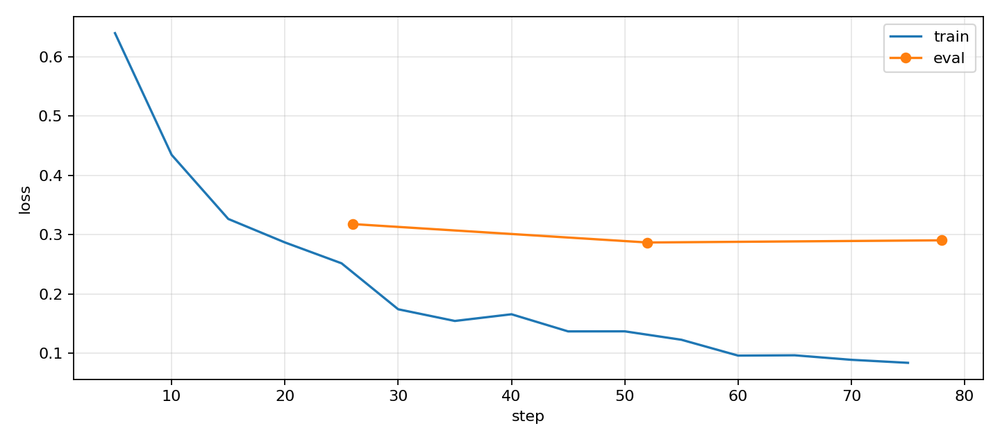

# ДЗ 3 SFT для вызова функций умного дома

Основной результат работы — [выполненный notebook](sft_function_calling_hw.ipynb). В нём сохранены реализация генерации, разбор данных, проверка маски loss, полное SFT, оценка на тесте и пять сценариев агента.

На предоставленном тесте exact match вырос с **26/60 (43,3%) до 59/60 (98,3%)**, а `tool_set_accuracy` — с **45/60 (75%) до 60/60 (100%)**. Все пять сценариев агента прошли. Оставшаяся ошибка — таймер на 90 минут вместо одного часа.

Используется `Qwen/Qwen2.5-0.5B-Instruct`, ревизия `7ae557604adf67be50417f59c2c2f167def9a775`. Обучаются все веса, без LoRA. Конфигурация согласована до запуска: 3 эпохи, learning rate `5e-5`, microbatch 8, accumulation 4 (эффективный batch 32), BF16, SDPA, AdamW fused, линейный scheduler с warmup 10%, seed 42, максимальная длина 2048. Оптимизация гиперпараметров по тесту не проводилась.

Исходные данные и симулятор сохранены без изменений. Train содержит 831 диалог (461 EN, 370 RU), validation — 91 (52 EN, 39 RU). Пересечений ID, scenario_id и полностью одинаковых диалогов между этими двумя частями нет. Тест содержит 60 запросов: 40 EN и 20 RU.

Теги `` добавлены к содержимому ответов assistant и вызовам функций, включая `<|im_end|>`. На всех 922 диалогах проверено, что текст после применения chat template не изменился. Ни один диалог не обрезается: максимальная длина train — 1285 токенов, validation — 1087. Дополнительно проверяются реальные labels после preprocessing и collation в `SFTTrainer`.

Метрики считаются кодом из шаблона: `tool_set_accuracy` проверяет набор имён функций, `exact_match` — ещё и аргументы с учётом значений по умолчанию. Вызовы с битым JSON считаются ошибками. В каждом языке знаменатель фиксирован; для общего результата нужно суммировать правильные ответы на всех 60 запросах, а не усреднять EN и RU без весов.

## Обучение

Один полный запуск на A100: 494 032 768 обучаемых параметров, 78 шагов оптимизатора за 109,49 секунды. Пиковая выделенная память PyTorch — 35,77 GiB. Время включает обучение и оценку после каждой эпохи; сохранение весов и последующие генерации в него не входят.

| Эпоха | Validation loss |
|---:|---:|
| 1 | 0,31804 |
| 2 | 0,28702 |
| 3 | 0,29066 |

Train loss в логах снизился с 0,6400 на шаге 5 до 0,0841 на шаге 75. Это средние по очередным интервалам логирования, а не оценка на фиксированной выборке. Для теста используется модель после всех трёх согласованных эпох.



Числа и окружение сохранены в [training_summary.json](outputs/training_summary.json), значения для графика — в [loss_history.json](outputs/loss_history.json).

## Тест и ошибки

| Модель | Язык | Запросов | Tool set accuracy | Exact match |
|---|---|---:|---:|---:|
| Base | EN | 40 | 30/40 (75%) | 22/40 (55%) |
| SFT | EN | 40 | 40/40 (100%) | 39/40 (97,5%) |
| Base | RU | 20 | 15/20 (75%) | 4/20 (20%) |
| SFT | RU | 20 | 20/20 (100%) | 20/20 (100%) |

Таблица по языкам сохранена в [eval_results.csv](outputs/eval_results.csv), все 120 ответов — в [test_predictions.csv](outputs/test_predictions.csv), ошибочные ответы с запросами и эталонами — в [error_analysis.json](outputs/error_analysis.json). Исправлены 33 из 34 неточных ответов base; 26 ранее точных остались точными. Среди ошибок base было 6 лишних вызовов на запросах без ожидаемого инструмента, 9 других несовпадений набора функций и 19 несовпадений аргументов или количества вызовов. Невалидного JSON не было.

Единственная неточность SFT — `en_14`: на `Start a one hour timer labeled laundry.` модель выдала `set_timer(minutes=90, label="laundry")` вместо 60 минут. Base на этом же запросе правильно задавал 60 минут, но использовал `label="Laundry"`, поэтому также не проходил строгий exact match. Утверждение «новых ошибочных запросов по exact match нет» здесь не означает отсутствия ухудшения отдельных аргументов.

В [сравнении десяти запросов](outputs/comparison.csv) SFT заменил несуществующую комнату `all` тремя вызовами для реальных комнат, отказался управлять гаражом и стал уточнять комнату в запросе без её названия. Изменение `milk` на `cartons of milk` в демонстрации списка покупок само по себе не объявляется улучшением: для неё нет эталонного ответа.

В [пяти сценариях агента](outputs/agent_scenarios.json) выполнены одиночный вызов, два вызова в одной реплике и последовательное изменение температуры 21 → 23 → 25. На благодарность и запрос открыть гараж инструментов не вызвано. Все результаты переданы обратно модели; повторное воспроизведение действий подтвердило состояние симулятора. При этом стилистика ответов не идеальна: после установки 25 градусов модель сказала `still at 25`, хотя температура только что изменилась.

## Выводы

1. На данном тесте SFT улучшил точность и соблюдение схемы инструментов. Результат относится к предоставленным 60 запросам; надёжность на произвольных командах здесь не измерялась.
2. Верное имя функции не гарантирует верных аргументов: ошибка длительности осталась при 100% `tool_set_accuracy`. Строгий exact match также требует просмотра конкретных ответов, поскольку учитывает регистр текстовой метки.
3. Третья эпоха не улучшила validation loss относительно второй. В следующем эксперименте можно проверить остановку после двух эпох по валидации. Один запуск и небольшой рост loss не дают основания уверенно утверждать переобучение; дополнительных запусков в этой работе не проводилось.

## Воспроизведение

Нужна CUDA GPU и окружение из [Dockerfile](Dockerfile). Версии Python-библиотек указаны в [requirements.txt](requirements.txt). Загрузить исходные данные с проверкой SHA256:

```bash
python download_data.py
```

Открыть notebook в GPU kernel и выполнить ячейки по порядку либо запустить:

```bash
python run_notebook.py
```

При повторном запуске модель и файлы в `outputs` будут пересозданы. Выполненная копия notebook сохраняется в `outputs/sft_function_calling_hw_executed.ipynb`. Веса записываются в `outputs/full_sft` и не входят в GitHub-публикацию.

Проверить сам агентный цикл без GPU и скачивания модели:

```bash
python test_agent.py
```

Эти проверки используют заданные ответы вместо модели, чтобы отдельно проверить цикл: несколько вызовов, последовательную обратную связь, отсутствие вызова, невалидный JSON, ошибку симулятора и лимит шагов. Оценка поведения обученной модели проводится отдельно на пяти сценариях в notebook. `smart_home.py` управляет только учебным симулятором; реальные устройства не используются.

Оригинальный шаблон и контрольные суммы входных файлов находятся в [starter](starter). Инфраструктурные файлы запуска и веса модели в публичную папку не входят.
