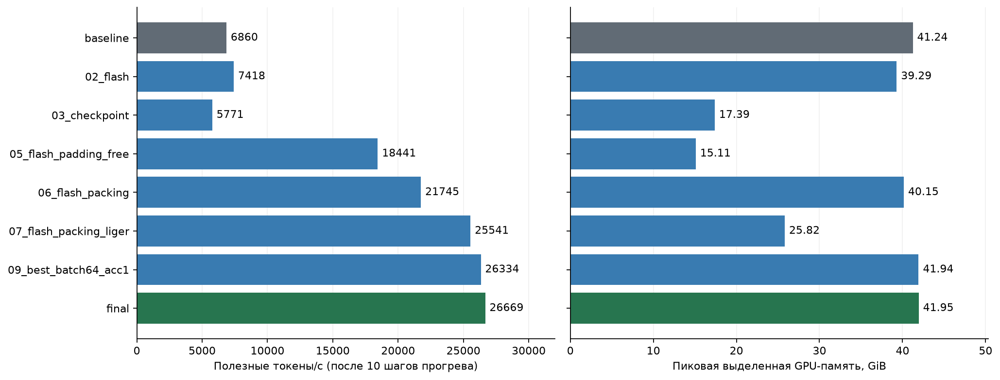
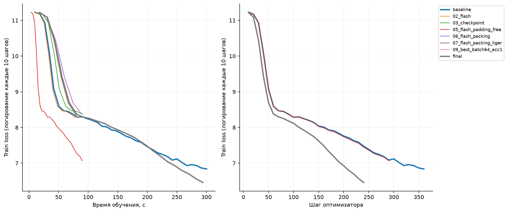
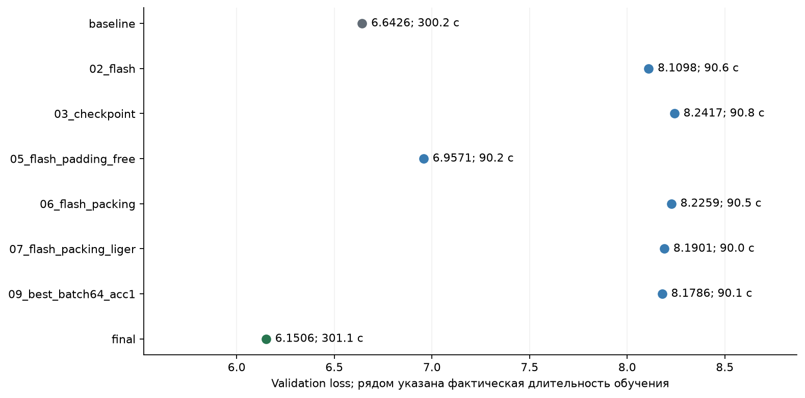

# ДЗ 2: ускорение pretrain и кольцевые коммуникации

Итоговая конфигурация — **FlashAttention 2 + BFD packing (с padding-free) + Liger, batch 64, accumulation 1**. За одинаковый лимит в 300 секунд она достигла **26 668,7 полезного токена/с против 6 860,0 у бейзлайна: ускорение S = 3,89×**. Validation loss составил **6,1506 против 6,6426**. Это сравнение при фиксированном времени: итоговый запуск обработал больше целевых токенов — 7,87 млн против 2,05 млн.

Серия выполнена 14 октября 2026 года. Все запуски прошли последовательно на одной **NVIDIA A100 80GB PCIe**. Проверки кольцевых коммуникаций также выполнены. В папке сохранены [итоговый train.py](train.py), его [summary.json](summary.json), [метрики всех запусков](results/runs.json), история loss и выполненный notebook.

## Бейзлайн и итоговый запуск

| Метрика | Бейзлайн | Итог |
|---|---:|---:|
| Лимит обучения, с | 300 | 300 |
| Фактическое время обучения, с | 300,20 | 301,14 |
| Полезные токены/с после прогрева измерителя | 6 860,0 | 26 668,7 |
| Токены/с за всё обучение, включая прогрев | 6 826,7 | 26 121,6 |
| Обработано целевых токенов | 2 049 376 | 7 866 272 |
| Шаги оптимизатора | 360 | 246 |
| Пик allocated, GiB | 41,24 | 41,95 |
| Пик reserved, GiB | 43,44 | 78,25 |
| Validation loss | 6,64258 | 6,15063 |

`S = 26668.701565704727 / 6860.019464938057 = 3.8875547951445255`.

Исходные значения: [бейзлайн](results/experiments/baseline/summary.json), [итог](results/experiments/final/summary.json). Пик выделенной памяти близок, но резерв аллокатора у итоговой конфигурации заметно выше. Поэтому результат нельзя описывать как ускорение при неизменном потреблении памяти.

## Что фиксируем

Бейзлайн — неизменённый [исходный train.py](starter/train.py). Его SHA256: `eb24509433f8cf1ed54e5b19356e9cb4431b54a842e18daebcb70db92d76eba3`. [Источники шаблонов](starter/sources.json) сохранены вместе с оригиналами.

Архитектура Qwen3 совпадает с ДЗ 1: 12 слоёв, hidden size 2048, intermediate size 8192, 16 attention heads и 8 KV heads, head dimension 128; 960 881 664 параметра. Модель в каждом эксперименте создаётся с нуля. Веса из ДЗ 1 не загружаются.

Данные и разбиение берём из шаблона **ДЗ 2**:

- `wikimedia/wikipedia`, `20231101.ru`, первые 50 500 статей в исходном порядке;
- первые 500 статей — validation, остальные 50 000 — train;
- из каждой статьи берём первые восемь абзацев длиной не менее 80 символов;
- токенизатор `ai-forever/rugpt3small_based_on_gpt2`; после токенизации оставляем абзацы с минимум 32 токенами;
- обрезаем абзац до 511 токенов и добавляем EOS; максимальная длина — 512;
- итоговый validation loss считаем на первых 512 абзацах validation, с весами по числу целевых токенов.

Ревизии датасета и токенизатора зафиксированы в шаблоне. Получено 244 768 train-абзацев и 2 928 validation-абзацев; средняя длина — 90,98 и 91,98 токена соответственно. Пересечений article_id нет. В итоговой оценке каждого успешного запуска ровно 50 694 целевых токена. Число абзацев, длины и контрольные суммы файлов сохранены в [data_manifest.json](results/data_manifest.json).

Во всех запусках остаются BF16, TF32, `adamw_torch_fused`, learning rate `3e-4`, `constant_with_warmup`, 200 шагов warmup, weight decay `0.01`, seed и data seed `42`. Метрики, коллатор и callback ограничения времени не меняются.

Бейзлайн и итоговый запуск ограничены 300 секундами обучения; короткие пробы — 90 секундами. Callback завершает текущий шаг оптимизатора, поэтому фактическое время может немного превышать лимит. Подготовка данных, инициализация модели и финальная оценка не входят в этот интервал.

Подготовка данных и все GPU-эксперименты прошли последовательно в одном контейнере с одной A100. Проверка UUID подтвердила, что устройство не менялось. Окружение: Python 3.11.11, PyTorch 2.6.0+cu118, драйвер NVIDIA 580.167.08, Transformers 4.56.2, TRL 0.23.1, Datasets 3.6.0, Accelerate 1.6.0, FlashAttention 2.7.3, Liger 0.6.2.

## Конфигурации

В бейзлайне SDPA, batch size 32, gradient accumulation 2. Все переключатели оптимизаций выключены. В таблице перечислены изменения относительно бейзлайна.

| Запуск | Изменения | Лимит, с |
|---|---|---:|
| baseline | Без изменений, исходный скрипт | 300 |
| 01_batch64_acc1 | Batch 64, accumulation 1 | 90 |
| 02_flash | FlashAttention 2 | 90 |
| 03_checkpoint | Activation checkpointing | 90 |
| 04_offload | Activation offloading | 90 |
| 05_flash_padding_free | FlashAttention 2 + padding-free | 90 |
| 06_flash_packing | FlashAttention 2 + BFD packing | 90 |
| 07_flash_packing_liger | FlashAttention 2 + BFD packing + Liger | 90 |
| 08_flash_packing_liger_compile | Предыдущее сочетание + torch.compile | 90 |
| 09_best_batch64_acc1 | FlashAttention 2 + BFD packing + Liger, batch 64, accumulation 1 | 90 |
| 09_best_batch128_acc1 | FlashAttention 2 + BFD packing + Liger, batch 128, accumulation 1 | 90 |
| final | Конфигурация 09_best_batch64_acc1, повтор с нуля | 300 |

В [TRL 0.23.1](https://huggingface.co/docs/trl/v0.23.1/sft_trainer) BFD packing автоматически включает padding-free. Поэтому `06_flash_packing` — сочетание механизмов. Сопоставление с `05_flash_padding_free` позволяет отдельно оценить добавление упаковки. При packing один элемент batch содержит несколько исходных абзацев, а при увеличении batch до 128 число элементов на шаг растёт. Поэтому во всех конфигурациях нельзя считать эффективный batch одинаковым только по произведению `batch_size × gradient_accumulation_steps`.

Итог выбран по максимальному положительному `tokens_per_second` среди успешных запусков с конечным validation loss. Падения и запуски без измеряемых шагов сохранены, но не участвуют в выборе. Для `torch.compile` процесс получил новый пустой кеш.

Всего выполнено 12 запусков: 11 разных конфигураций и повтор победителя на 300 секунд. Успешны 7 разных конфигураций и итоговый повтор. Проверены batch/accumulation, attention backend, checkpointing, offloading, padding-free, packing, Liger и compile; сочетания включают FlashAttention с padding-free, packing, Liger и compile. Каждый запуск имеет собственный `output_dir`; изменения настроек относительно исходного шаблона сохранены в [results/configs](results/configs).

## Результаты всех экспериментов

| Запуск | Статус | Лимит, с | Факт, с | Токены/с | S к baseline | Peak allocated, GiB | Peak reserved, GiB | Validation loss | Шаги |
|---|---|---:|---:|---:|---:|---:|---:|---:|---:|
| `baseline` | completed | 300 | 300.20 | 6860.0 | 1.000 | 41.24 | 43.44 | 6.64258 | 360 |
| `01_batch64_acc1` | failed | 90 | — | — | — | — | — | — | — |
| `02_flash` | completed | 90 | 90.65 | 7417.9 | 1.081 | 39.29 | 41.01 | 8.10980 | 116 |
| `03_checkpoint` | completed | 90 | 90.83 | 5770.7 | 0.841 | 17.39 | 23.97 | 8.24166 | 90 |
| `04_offload` | failed | 90 | — | — | — | — | — | — | — |
| `05_flash_padding_free` | completed | 90 | 90.19 | 18441.1 | 2.688 | 15.11 | 21.24 | 6.95708 | 291 |
| `06_flash_packing` | completed | 90 | 90.54 | 21745.5 | 3.170 | 40.15 | 76.20 | 8.22593 | 61 |
| `07_flash_packing_liger` | completed | 90 | 90.02 | 25541.4 | 3.723 | 25.82 | 33.15 | 8.19009 | 67 |
| `08_flash_packing_liger_compile` | failed | 90 | — | — | — | — | — | — | — |
| `09_best_batch64_acc1` | completed | 90 | 90.11 | 26333.5 | 3.839 | 41.94 | 58.50 | 8.17864 | 69 |
| `09_best_batch128_acc1` | failed | 90 | — | — | — | — | — | — | — |
| `final` | completed | 300 | 301.14 | 26668.7 | 3.888 | 41.95 | 78.25 | 6.15063 | 246 |

Таблица автоматически восстанавливается из [runs.json](results/runs.json) скриптом [analyse_results.py](analyse_results.py). `—` означает отсутствие итоговой метрики после ошибки, а не нулевое значение. Все полученные `summary.json` сохранены без изменений в [results/experiments](results/experiments). Публичная выгрузка содержит конфиги, статусы, метрики и историю loss; служебные идентификаторы, адреса инфраструктуры и сырые логи остаются в локальном архиве.







## Выводы

1. **Основной прирост дал padding-free.** При добавлении к FlashAttention 2 скорость выросла с 7 418 до 18 441 токена/с, а пик allocated снизился с 39,29 до 15,11 GiB. В датасете много коротких абзацев: средняя длина train — около 91 токена при максимуме 512. Удаление padding сокращает работу с заполнителями и хранение соответствующих активаций. TRL объединяет последовательности для вычислений, сохраняя границы примеров через position IDs; это объясняет направление эффекта. Точную долю padding по одной средней длине определить нельзя: исходный коллатор дополняет до максимума внутри batch. [Механизм в TRL](https://huggingface.co/docs/trl/v0.23.1/sft_trainer).

2. **Liger дополнил packing.** При неизменных batch 32 и accumulation 2 сочетание FlashAttention 2 + packing + Liger дало 25 541 вместо 21 745 токенов/с (**+17,5%**), а пик allocated снизился с 40,15 до 25,82 GiB (**−35,7%**). Такое направление согласуется с устройством Liger: слияние операций и вычисление частями уменьшают промежуточные тензоры и обращения к памяти. С сочетанием FlashAttention 2 + packing + Liger удалось запустить batch 64; вариант SDPA с batch 64 завершился OOM. Отдельный вклад каждого механизма в возможность разместить batch 64 не изолирован. [Описание Liger 0.6.2](https://github.com/linkedin/Liger-Kernel/blob/v0.6.2/README.md).

3. **Экономия памяти не гарантирует ускорение.** Checkpointing снизил пик allocated с 41,24 до 17,39 GiB, но скорость упала с 6 860 до 5 771 токена/с. Это ожидаемый обмен: часть активаций не сохраняется, а вычисляется заново на backward. В данной серии приоритетом были токены/с, поэтому checkpointing не вошёл в итоговый вариант. [Механизм checkpointing в PyTorch](https://docs.pytorch.org/docs/2.6/checkpoint.html).

Выводы относятся к этой модели, данным, GPU и версиям библиотек. Механистические объяснения опираются на устройство методов; разбор времени по отдельным GPU-ядрам не проводился.

## Неуспешные конфигурации

- **SDPA, batch 64, accumulation 1:** CUDA OOM при запросе 6,14 GiB и 5,00 GiB свободной памяти. Увеличение microbatch без других оптимизаций не поместилось.
- **SDPA + activation offloading:** ошибка `attn_bias is not correctly aligned (strideH)`: stride 35721 должен быть кратен 4. Для этой конфигурации скорость и итоговый loss не получены; вывод о пользе или вреде offloading по скорости сделать нельзя.
- **FlashAttention 2 + packing + Liger + torch.compile:** проверка исходного шаблона остановила запуск с `FloatingPointError: Значение loss не валидное`. В логе также есть предупреждение о graph break, но его причинная связь с невалидным loss не установлена. Это не доказательство, что compile не работает для любых сочетаний.
- **FlashAttention 2 + packing + Liger, batch 128, accumulation 1:** CUDA OOM. Успешным увеличением microbatch в этой серии остался batch 64.

Эти попытки учитываются как проверенные конфигурации, но не как успешные измерения. Ошибки подготовки окружения до начала серии в таблицу обучения не входят.

## Как читать метрики

Главная метрика из шаблона — число **целевых токенов** (`labels != -100`) за секунду после первых десяти шагов оптимизатора. Эти десять шагов прогрева измерителя отличаются от 200 шагов warmup learning rate. Дополнительно сохраняется скорость за всё время обучения, включая прогрев; она особенно существенна для коротких запусков с компиляцией.

Ускорение для сдачи: `S = tokens_per_second(final) / tokens_per_second(baseline)`. Память — максимумы `torch.cuda.max_memory_allocated` и `max_memory_reserved` в GiB (2^30 байт), зафиксированные до итоговой оценки. Это показатели аллокатора PyTorch, а не полная занятость GPU из `nvidia-smi`.

Validation loss короткой пробы нельзя напрямую трактовать как улучшение или ухудшение качества относительно 300-секундного бейзлайна: время обучения различается. Бейзлайн и итоговый запуск сравниваются при одинаковом лимите времени, но могут увидеть разное число токенов и пройти разное число шагов LR warmup.

У итогового запуска loss ниже после того же лимита времени, однако он обработал в 3,84 раза больше целевых токенов, сделал 246 шагов вместо 360 и использовал packing. Поэтому результат не доказывает улучшение обучения при одинаковом числе токенов. Показателен и короткий packing-запуск: он быстрее padding-free по токенам/с, но имеет loss 8,2259 против 6,9571 и всего 61 шаг против 291. При фиксированном warmup в 200 шагов это разные стадии LR scheduler; одновременно меняются состав batch и число токенов на шаг. Причины различия loss здесь не изолированы.

Каждая конфигурация измерена с одним seed; доверительные интервалы и устойчивость к другим seed не оценивались. Повтор победителя на 300 секунд подтверждает выигрыш в данном запуске, но не заменяет серию повторных измерений.

Графики train loss строятся по исходным логам каждые десять шагов, без сглаживания. Итоговый validation loss измеряется один раз после каждого обучения; непрерывной кривой validation loss здесь нет.

## Кольцевые коммуникации

[collectives.py](collectives.py) реализует reduce-scatter, all-gather и all-reduce через `isend`/`irecv` соседям в кольце. В reduce-scatter каждый процесс после `world_size - 1` обменов получает суммарный блок своего rank. All-gather распространяет эти блоки по кольцу; all-reduce последовательно вызывает обе операции. Исходные входные тензоры сохраняются.

[communications.ipynb](communications.ipynb) выполнен локально на CPU с Gloo. Проверки для 1, 2, 3 и 4 процессов прошли: результаты сравнены со встроенными коллективами PyTorch на float64, размеры блоков 1, 7 и 31. Тест также проверяет неизменность входа. Это проверка корректности, не бенчмарк сетевых коммуникаций.

## Воспроизведение

Окружение обучения: [Dockerfile](Dockerfile), PyTorch 2.6.0 / CUDA 11.8, Transformers 4.56.2, TRL 0.23.1, Datasets 3.6.0, Accelerate 1.6.0, FlashAttention 2.7.3, Liger 0.6.2.

На одной A100 в этом окружении итоговый вариант запускается командой `python train.py`: скрипт подготавливает данные при отсутствии кеша и обучает новую модель 300 секунд. Результат сохраняется в `results/final/summary.json`. Исходный бейзлайн находится в `starter/train.py`; у итогового файла изменены только разрешённые настройки attention, batch/accumulation, packing, Liger и `output_dir`.

В обёртке подготовки данных есть обход наблюдавшегося сбоя `PyGILState_Release` при завершении интерпретатора после streaming-чтения: `os._exit(0)` вызывается только после успешной подготовки, повторного чтения датасета, всех проверок и сохранения контрольных сумм. Ошибки самой подготовки по-прежнему завершают процесс с ошибкой. Исходный `train.py` и процессы обучения этот обход не используют.

- [run_suite.py](run_suite.py) — независимые запуски с нуля, логи, проверка GPU и выбор итоговой конфигурации.
- [run_experiment.py](run_experiment.py) — только разрешённые переопределения конфигурации исходного скрипта.
- [prepare_dataset.py](prepare_dataset.py) — подготовка по исходному шаблону, проверки и контрольные суммы данных.
- [analyse_results.py](analyse_results.py) — таблица и графики из сохранённых результатов.

Для воспроизведения графиков без GPU достаточно установить `matplotlib` и выполнить `python analyse_results.py`. Для проверки коммуникаций в окружении с PyTorch можно выполнить `python -m torch.distributed.run --nnodes=1 --nproc-per-node=4 --master-addr=127.0.0.1 --master-port=29500 check.py` либо запустить все ячейки [communications.ipynb](communications.ipynb).

Для повторения всей серии нужен чистый рабочий каталог: `run_suite.py` создаёт ссылку `results` на каталог новых результатов. Например, из корня `hw2` можно подготовить отдельную копию и выполнить команды внутри окружения из Dockerfile:

```bash
mkdir -p /tmp/hw2-rerun
cp run_suite.py run_experiment.py inspect_runtime.py prepare_dataset.py /tmp/hw2-rerun/
cp -R starter configs /tmp/hw2-rerun/
cd /tmp/hw2-rerun
python prepare_dataset.py data
python run_suite.py --export /tmp/hw2-rerun-results
```

Серия завершилась успешно, результаты скачаны и проверены. Для проверки ДЗ и повторения обучения внутренний сервис запуска не требуется.
