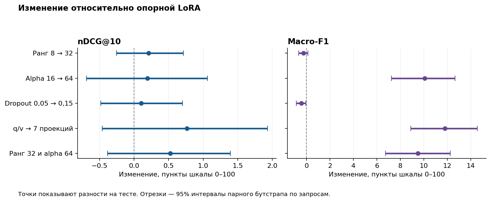

# ДЗ 4. Full Fine-Tuning и LoRA в товарном поиске

Сравниваем способы дообучить `Qwen/Qwen2.5-1.5B-Instruct` для товарного поиска. Измеряем, насколько высоко модель ставит точные совпадения и как хорошо отличает их от замен, дополнений и нерелевантных товаров.

По validation nDCG@10 выбрана **LoRA с рангом 8 и alpha 64 в q/v**. На тесте она обошла Full FT по обеим метрикам и потребовала на 20,25 GiB меньше пиковой памяти. Обучение заняло на 1 мин 45 с дольше.

## Данные

В опубликованном Amazon ESCI 2 621 288 пар «запрос — товар». У одного запроса есть несколько товаров, у каждой пары есть оценка релевантности. Это позволяет на одних данных проверить выдачу и ошибки по классам. В американской части для ранжирования 601 354 пары. Чтобы провести семь дообучений при сопоставимом бюджете, выбрали подмножество запросов и сохранили все их исходные товары-кандидаты. Модели видят запрос и заголовок товара. [Исходные данные Amazon](https://github.com/amazon-science/esci-data) · [Описание датасета](https://arxiv.org/abs/2206.06588)

| Выборка | Запросов | Пар | E, точное | S, замена | C, дополнение | I, нерелевантен |
|---|---:|---:|---:|---:|---:|---:|
| Train | 600 | 12 039 | 5 065 | 4 358 | 469 | 2 147 |
| Validation | 128 | 2 450 | 1 063 | 842 | 82 | 463 |
| Test | 256 | 5 285 | 2 330 | 1 922 | 217 | 816 |

Train и validation взяли из опубликованного Amazon train, test — из опубликованного test. Выбирали целые запросы по хешу с seed 42. Тексты запросов после нормализации между частями не пересекаются. В тесте от 8 до 85 товаров на запрос, медиана 16. [Состав и контрольные суммы](results/dataset_manifest.json)

Пример из train — четыре кандидата для `newest ipad model`. Подписи ниже передают исходные заголовки в сокращении. Метки взяты из датасета на момент его разметки.

| ID пары | Товар | Метка Amazon |
|---:|---|---|
| 1441054 | Apple iPad 9.7″, 32 GB, «2017 Newest Model», восстановленный | E |
| 1441042 | Apple iPad Mini 2019, 64 GB | S |
| 1441050 | Apple Pencil | C |
| 1441048 | Apple AirPods с беспроводным зарядным футляром | I |

## Условия сравнения

У исходной модели и всех обученных вариантов одинаковые инструкция, языковая голова Qwen и способ оценки. На месте первого токена ответа берём вероятности четырёх букв E/S/C/I. Самая вероятная буква задаёт класс. По ожидаемой релевантности `P(E) + 0,1·P(S) + 0,01·P(C)` сортируем кандидатов внутри запроса. Для обучения используем cross-entropy по всему словарю на целевой букве.

- **nDCG@10** измеряет качество первых десяти позиций. Считаем его отдельно для каждого запроса с линейными весами Amazon и усредняем. Все 256 тестовых запросов имеют положительный идеальный DCG.
- **Macro-F1** усредняет F1 четырёх классов с равными весами. Дополнения занимают лишь 217 из 5 285 тестовых пар (4,1%). Падение качества на них слабо влияет на nDCG, но отражается в macro-F1.

Full FT обновляет все веса Qwen. У LoRA исходные веса заморожены. Опорная LoRA использует `r=8`, `alpha=16`, `dropout=0.05` и проекции `q_proj,v_proj`. В четырёх опытах меняли по одному из этих параметров. В дополнительном опыте одновременно подняли ранг до 32 и alpha до 64, сохранив масштаб опорной LoRA `alpha/r=2`. Лучший вариант LoRA выбираем по validation nDCG@10, при равенстве — по validation macro-F1. Для ручного сравнения заранее выбрали опорную LoRA.

Все дообучения начинают с одной ревизии модели и получают одни и те же примеры в одном порядке. Две эпохи, batch 32, общий LR `5e-5`, AdamW, линейный warmup 6%, затем линейное снижение LR, длина контекста до 256 токенов, BF16 autocast. [Подробности протокола](PROTOCOL.md) · [Конфигурации](protocol.json) · [Исходная модель](https://huggingface.co/Qwen/Qwen2.5-1.5B-Instruct)

## Результаты

Все восемь конфигураций оценены на одних и тех же 2 450 validation-парах и 5 285 тестовых парах. Каждое дообучение заняло 754 шага и обработало 24 078 пар за две эпохи. Во всех трёх частях ни один заголовок не потребовал усечения. Основная серия прошла последовательно на одной NVIDIA A100 80GB PCIe. Контроль `32/64` прошёл на отдельно выделенной A100 той же модели. Версии ПО и хеш порядка обучающих примеров совпали.

| Вариант | Обучаемых параметров | Время, мин:с | Пик, GiB | Val nDCG@10 | Val macro-F1 | Test nDCG@10 | Test macro-F1 |
|---|---:|---:|---:|---:|---:|---:|---:|
| Исходная Qwen | 0 | — | — | 0,7294 | 0,3707 | 0,7119 | 0,3571 |
| Full FT | 1 543 714 304 | 11:35 | 47,81 | 0,7412 | 0,4067 | 0,7203 | 0,3696 |
| LoRA, опорная · q/v, 8/16, p=0,05 | 1 089 536 | 10:03 | 27,56 | 0,7623 | 0,4002 | 0,7478 | 0,3770 |
| Только ранг · q/v, 32/16, p=0,05 | 4 358 144 | 11:05 | 27,62 | 0,7630 | 0,3964 | 0,7499 | 0,3744 |
| **Только alpha · q/v, 8/64, p=0,05** | **1 089 536** | **13:20** | **27,56** | **0,7655** | 0,4750 | **0,7497** | **0,4777** |
| Только dropout · q/v, 8/16, p=0,15 | 1 089 536 | 13:30 | 27,56 | 0,7594 | 0,3977 | 0,7488 | 0,3725 |
| Только слои · 7 проекций, 8/16, p=0,05 | 9 232 384 | 7:28 | 37,58 | 0,7650 | 0,5021 | 0,7555 | 0,4949 |
| Контроль масштаба · q/v, 32/64, p=0,05 | 4 358 144 | 4:19 | 27,62 | 0,7647 | 0,4724 | 0,7531 | 0,4719 |

В первом столбце указаны `r/alpha` и вероятность dropout `p`. Жирным выделен выбор по validation nDCG@10. Время включает тренировочный цикл, пик отражает выделенную под тензоры память PyTorch. Для каждой конфигурации время замерялось один раз. В основной серии даже два опыта q/v с одинаковым числом параметров заняли 10:03 и 13:20. Поэтому разницу во времени между запусками нельзя приписать одному значению alpha. [Таблица без округления](results/comparison.csv) · [Метрики по классам](results/class_metrics.csv) · [Замеры и предсказания каждого запуска](results)

### Что изменили параметры LoRA

Разности ниже рассчитаны на тесте относительно опорной LoRA. На графике единица означает 0,01 исходной метрики. Доверительные интервалы получены парным бутстрапом целых списков товаров по 256 запросам. Они показывают чувствительность результата к составу тестовых запросов при единственном обучении каждого варианта. [Все разности и интервалы](results/paired_intervals.csv)



- **Ранг 8 → 32 при alpha=16.** Обучаемых параметров стало вчетверо больше. nDCG@10 сдвинулся на +0,0021, macro-F1 на −0,0026. Оба интервала включают ноль. Обе модели правильно нашли лишь 2 из 217 дополнений. При фиксированной alpha множитель `alpha/r` уменьшился с 2 до 0,5.
- **Alpha 16 → 64 при r=8.** Параметров и пиковой памяти столько же, сколько у опорной LoRA. nDCG@10 изменился на +0,0019, а macro-F1 на **+0,1008** (95% интервал от +0,0725 до +0,1265). Модель стала чаще выбирать редкий класс C. При alpha=16 она присвоила его 5 товарам и угадала 2. При alpha=64 выбрала 115 и угадала 51 из тех же 217 истинных дополнений. F1 класса C вырос с 0,0180 до 0,3072. Это дало около 0,0723 из общего прироста 0,1008 в macro-F1.
- **Dropout 0,05 → 0,15.** Изменение nDCG@10 составило +0,0010 (интервал от −0,0048 до +0,0070). Macro-F1 немного снизился, на 0,0045 (интервал разности от −0,0085 до −0,0006). Оснований повышать dropout в этой серии мало.
- **q/v → семь проекций.** Число обучаемых параметров выросло с 1,09 до 9,23 млн, пик с 27,56 до 37,58 GiB. Прирост macro-F1 составил **0,1179** (интервал от +0,0889 до +0,1455), правильно распознаны 69 из 217 дополнений. Прирост nDCG@10 составил 0,0077 (от −0,0046 до +0,0193). Опыт одновременно меняет размещение адаптеров и их ёмкость.
- **Контроль масштаба, 8/16 → 32/64.** При одинаковом `alpha/r=2` macro-F1 вырос с 0,3770 до 0,4719, nDCG@10 с 0,7478 до 0,7531. При фиксированном ранге 32 повышение alpha с 16 до 64 также добавило 0,0975 macro-F1. А при фиксированной alpha=64 рост ранга с 8 до 32 дал −0,0058 macro-F1 (от −0,0135 до +0,0021). В этих четырёх опытах рост macro-F1 повторился при повышении alpha на обоих рангах. Самого отношения `alpha/r` недостаточно, чтобы предсказать результат.

## Ручная оценка на восьми одинаковых парах

До просмотра предсказаний выбрали по два примера каждого эталонного класса с разными запросами. Прочитали запросы и названия товаров, затем сравнили решения трёх моделей. **E** означает точное совпадение, **S** замену, **C** дополнение, **I** нерелевантный товар. Названия в таблице сокращены. [Полные заголовки, ID, метки и позиции товаров](results/manual_predictions.csv)

| Запрос и предложенный товар | Amazon | Base | Full | LoRA¹ | Разбор |
|---|:---:|:---:|:---:|:---:|---|
| `swimsuit for girls 7-8` → купальник Kanu Surf, размер 8 | E | E | E | E | Предмет и размер совпадают. При одинаковом классе модели поставили товар на 6-е, 9-е и 11-е место. Опорная LoRA оставила его сразу за пределами первой десятки. |
| `pearl percussion kit` → набор ударных ENNBOM | E | S | S | S | Все три сочли набор заменой. Если слово Pearl задаёт марку, это обоснованно. Принадлежность набора к Pearl по заголовку подтвердить трудно. |
| `hocus pocus shirt` → футболка с надписями Hocus Pocus и Sanderson Sisters | S | E | E | E | В названии одновременно присутствуют нужный предмет и тема. По видимому тексту точное совпадение правдоподобно. Основание для эталонной S здесь неочевидно. |
| `crystal light packets orange` → пакетики Crystal Light, клубника–апельсин–банан | S | S | E | S | Марка и формат совпадают. Смесь отличается от простого апельсинового вкуса. Base и LoRA сохранили это различие, Full дал E. |
| `apple earbuds` → переходник для проводных наушников | C | S | E | S | Покупатель ищет наушники. Переходник помогает их подключить, поэтому эталон C объясним. Все три модели завысили степень соответствия. |
| `women's jewelry rings+dinner rings` → шкатулка для украшений | C | I | I | I | В шкатулке можно хранить кольца. Все три модели пропустили эту связь и выбрали I. |
| `!qscreen fence without holes` → свободностоящее ограждение для питомцев | I | S | I | I | Условие монтажа без отверстий делает S понятной. Назначение ограждения для питомцев отличается от экранного забора, хотя сам запрос сформулирован неясно. Full и LoRA совпали с эталоном. |
| `hummus without tahini` → банка чистого тахини, предложенная для хумуса | I | S | S | S | Слово `without` прямо исключает предлагаемый ингредиент. Все три приняли банку тахини за замену хумусу. |

¹ Для ручной проверки использована заранее выбранная опорная LoRA `8/16, q/v`. Восьмёрка сбалансирована по классам вручную заданной квотой. Для оценки общего качества используем весь тест.

## Итоговый выбор

**Для этих данных и бюджета выбираем LoRA `r=8, alpha=64, dropout=0.05` в q/v.** Она выиграла по заранее выбранной validation nDCG@10. На тесте разница с Full FT составила +0,0294 nDCG@10 (95% интервал от +0,0088 до +0,0526) и +0,1081 macro-F1 (от +0,0692 до +0,1460). Обучались 1,09 млн параметров из 1,545 млрд с учётом адаптеров, около 0,071%. Пик памяти ниже Full FT на 20,25 GiB (42,4%). По времени этот запуск проиграл Full FT 1 мин 45 с.

Вариант с семью проекциями дал самые высокие тестовые числа — 0,7555 и 0,4949. На validation по nDCG@10 у него 0,7650, у выбранной LoRA 0,7655. Фиксация критерия заранее позволяет показать оба результата и сохранить независимость теста при выборе модели. У самого Full FT прирост относительно исходной Qwen составил +0,0084 nDCG@10 и +0,0125 macro-F1. Оба интервала этой разности включают ноль. Сравнение относится к общему LR `5e-5`, двум эпохам и одному seed.

## Как воспроизвести

Из папки `hw4_lora` на машине с поддержкой Docker и NVIDIA GPU:

```bash
docker build -t hw4-lora .
docker run --rm --gpus 1 -v "$PWD:/work" -w /work hw4-lora bash -lc '
  python prepare.py &&
  python test_metrics.py &&
  python run_suite.py --out rerun &&
  python analyze.py --results rerun &&
  python plot.py --results rerun
'
```

`prepare.py` загружает два оригинальных Parquet, сверяет SHA256, собирает три JSONL и фиксирует ID ручной проверки. `run_suite.py` запускает каждый вариант отдельным процессом. В `--out` сохраняются параметры, замеры, лосс и вероятности для каждой пары на validation и test. Чтобы сохранить веса Full FT и адаптеры LoRA локально, добавьте `--checkpoint-dir checkpoints`. Для одного опыта используйте, например, `--runs lora_ref` и отдельный выходной каталог.

Для пересчёта таблиц и графика по опубликованным предсказаниям достаточно CPU. В Python 3.11 или 3.12 выполните:

```bash
python -m pip install numpy==1.26.4 matplotlib==3.9.4
python test_metrics.py
python analyze.py --results results
python plot.py --results results
```
