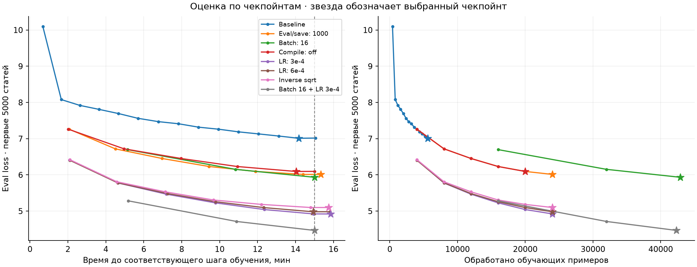
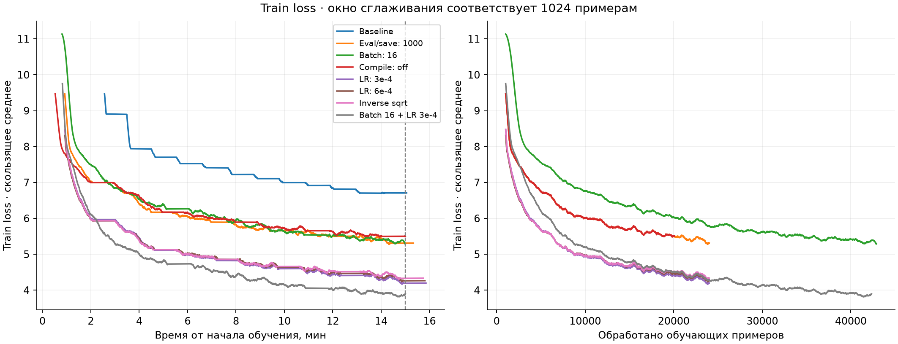
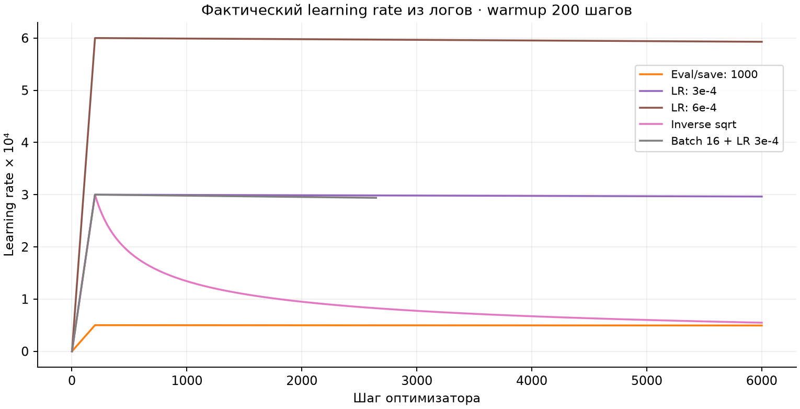

# Мини-претрейн Qwen3 на русской Википедии

Проведено восемь запусков с инициализацией с нуля. Минимальный итоговый `eval_loss` среди проверенных конфигураций — **4.466739**, `exp(eval_loss)` — **87.07**. Этот результат получен с batch size 16, learning rate `3e-4`, линейным scheduler, `torch_compile=True` и оценкой/сохранением каждые 1000 шагов.

## Данные и модель

Данные загружены вызовом:

```python
load_dataset("wikimedia/wikipedia", "20231101.ru", split="train")
```

В датасете 1 945 063 статьи. Первые **5000** в исходном порядке выделены для оценки; оставшиеся **1 940 063** — для обучения. Перемешивания перед разделением нет. В коде эта контрольная выборка называется `eval_dataset`, в условии задания — test.

Использован токенизатор `ai-forever/rugpt3small_based_on_gpt2`, словарь 50 257 токенов. Каждая статья обрезается или дополняется до **512** позиций. Короткие статьи не объединяются между собой. `pad_token = eos_token`, позиции padding исключаются из loss с помощью `labels=-100` по `attention_mask`. Порядок статей проверен после сохранения и повторного чтения 32 parquet-файлов; граница выборок совпадает во всех запусках. Проверки и идентификаторы сохранены в [манифесте данных](results/07_combined/dataset_manifest.json).

Модель создаётся из конфигурации Qwen3 с **960 881 664 параметрами**: 12 слоёв, hidden size 2048, intermediate size 8192, 16 attention heads, 8 KV heads, head dimension 128. Используется Flash Attention 2. Архитектура, функция разделения данных и callback ограничения времени совпадают с [исходным шаблоном](starter/your_solution.py). Проверяется их AST, без учёта комментариев и форматирования.

Каждый запуск начинается с новых случайных весов при `seed=42`; дообучения предыдущего чекпойнта нет. Для компиляции используются отдельные пустые кэши запусков.

## Условия обучения

Одна **NVIDIA A100 80GB PCIe**, PyTorch `2.6.0+cu118`, Transformers `4.52.0`, Datasets `3.6.0`, Accelerate `1.6.0`, Flash Attention `2.7.3`.

Во всех запусках фиксированы:

- `optim=adamw_torch_fused`, `weight_decay=0.01`;
- `bf16=True`, `tf32=True`, `gradient_checkpointing=False`;
- `gradient_accumulation_steps=1`, `per_device_eval_batch_size=8`;
- `warmup_steps=200`, `num_train_epochs=1`, `logging_steps=1`;
- выбор чекпойнта по минимальному `eval_loss` через `load_best_model_at_end=True`.

Сравнивались частота оценки/сохранения, batch size, `torch_compile`, learning rate и scheduler. Оптимизатор, dtype и накопление градиентов отдельно не сравнивались.

**Как измерялось время.** Во всех запусках использован исходный лимит 900 секунд. Callback проверяет его в конце шага оптимизатора. Компиляция, промежуточные оценки и сохранения входят в это окно; подготовка данных происходит до него. Если оценка пересекла отметку 900 секунд, остановка происходит после следующего шага. Поэтому фактическое время остановки составило 900.01–951.10 секунды. Финальный запуск остановлен на **900.05 секунды**. Финальная оценка и сохранение выполняются после остановки; полный `trainer.train()` финального запуска занял 958.46 секунды.

Для `torch_compile` задан `TRITON_PTXAS_PATH=/usr/local/cuda/bin/ptxas`: использован компилятор CUDA 11.8, совместимый с установленным драйвером. Окружение зафиксировано в [environment.json](results/07_combined/environment.json), зависимости — в [Dockerfile](Dockerfile).

## Эксперименты

В столбце «Изменение» указана конфигурация, с которой сравнивается запуск. Экспериментальные конфигурации заданы в [configs](configs); полные эффективные параметры каждого запуска находятся в его `training_args.json`.

| Запуск | Изменение относительно указанного запуска | Примеры за запуск | Шаги оптимизатора | Стоп, с | Итоговый eval_loss |
|---|---|---:|---:|---:|---:|
| `baseline` | Batch 4, LR `5e-5`, linear, compile; eval/save каждые 100 шагов | 5 604 | 1 401 | 903.09 | 7.0107 |
| `01_eval1000` | К `baseline`: eval/save каждые 1000 шагов | 24 004 | 6 001 | 919.94 | 6.0122 |
| `02_batch16` | К `01_eval1000`: batch 16 | 42 896 | 2 681 | 900.12 | 5.9337 |
| `03_compile_off` | К `01_eval1000`: compile выключен | 20 076 | 5 019 | 900.01 | 6.0946 |
| `04_lr3e4` | К `01_eval1000`: LR `3e-4` | 24 004 | 6 001 | 951.10 | 4.9209 |
| `05_lr_extra` | К `01_eval1000`: LR `6e-4` | 24 004 | 6 001 | 948.56 | 4.9818 |
| `06_inverse_sqrt` | К `04_lr3e4`: scheduler `inverse_sqrt` | 24 004 | 6 001 | 944.87 | 5.0991 |
| `07_combined` | К `04_lr3e4`: batch 16; сочетание выбранных параметров | 42 336 | 2 646 | 900.05 | **4.4667** |

Итоговый `eval_loss` измерен на экспортированном выбранном чекпойнте. Он не всегда совпадает с последними весами: у `baseline` выбран шаг 1400 из 1401, у `03_compile_off` — 5000 из 5019, у `05_lr_extra` — 6000 из 6001. В финальном запуске выбран последний шаг 2646. Оценки последних весов также сохранены в `facts.json`.

Расширенная [таблица метрик](results/metrics.md) содержит гиперпараметры и `exp(eval_loss)`. Последнее используется как оценка perplexity при принятом в Trainer усреднении loss.

### Почему помогла более редкая оценка

Исследовательский вопрос: **почему оценка и сохранение каждые 1000 шагов дали меньший итоговый loss, чем каждые 100 шагов?** Сравниваются `baseline` и `01_eval1000`; остальные параметры обучения сохранены.

На одинаковом шаге 1000 loss практически совпал: 7.2614 и 7.2612. При этом на промежуточную оценку до остановки ушло 640.28 и 267.56 секунды, а выполнить удалось 1401 и 6001 обновление весов соответственно. Итоговый loss составил 7.0107 и 6.0122. Фактическое время остановки — 903.09 и 919.94 секунды из-за описанного выше поведения callback.

Оценка заняла 70.9% и 29.1% времени до остановки соответственно. Фактическая скорость с учётом всех расходов запуска составила 6.21 и 26.09 примера/с.

**Вывод:** сокращение частоты оценки и сохранения освободило время для обучения. Выигрыш объясняется большим числом обновлений в доступное время; в проверенной точке с одинаковым числом обновлений улучшения loss не видно. Частоты оценки и сохранения менялись совместно, поэтому их отдельные вклады этим сравнением не определяются.

### Что дало увеличение batch size

Исследовательский вопрос: **что дало увеличение batch size с 4 до 16 при ограничении времени обучения?** Сравниваются `01_eval1000` и `02_batch16` с одинаковым LR `5e-5`.

| Метрика | Batch 4 | Batch 16 |
|---|---:|---:|
| Обработано примеров до остановки | 24 004 | 42 896 |
| Итоговый eval_loss | 6.0122 | **5.9337** |
| Eval_loss после 16 000 примеров | **6.2324** | 6.6977 |

Средняя скорость с учётом всех расходов запуска выросла с 26.09 до 47.66 примера/с. Число обновлений весов уменьшилось с 6001 до 2681.

**Вывод:** batch 16 оказался выгоднее при ограничении времени: удалось обработать больше данных и получить меньший итоговый loss. В общей точке после 16000 примеров преимущество было у batch 4. Таким образом, выигрыш по итогам ограниченного по времени запуска не означает преимущества при одинаковом объёме обработанных данных.

На 16000 примеров приходятся 4000 обновлений весов у малого батча и 1000 у большого. Warmup и интервалы оценки остались заданы в шагах: warmup охватывает 800 и 3200 примеров, а между оценками проходит 4000 и 16000 примеров соответственно. Эти различия тоже входят в сравнение конфигураций.

### Окупилась ли компиляция

Исследовательский вопрос: **окупилась ли компиляция за короткий запуск?** Сравниваются `03_compile_off` и `01_eval1000` с batch 4, LR `5e-5` и оценкой/сохранением каждые 1000 шагов.

| Метрика | Без compile | С compile |
|---|---:|---:|
| Время до завершения первого шага | 1.31 с | 28.37 с |
| Средняя скорость, включая оценки и сохранения | 22.31 примера/с | **26.09 примера/с** |
| Eval loss на одинаковом шаге 5000 | 6.0946 | 6.0953 |

Время первого шага включает начальную компиляцию, если она включена; это не отдельный замер только компиляции. До остановки выполнены 5019 и 6001 обновление весов, итоговый loss составил 6.0946 и 6.0122 соответственно.

**Вывод:** в наших условиях компиляция окупилась: несмотря на долгий первый шаг, средняя скорость за запуск выросла примерно на 17%. При одинаковом числе обновлений loss практически совпал; преимущество компиляции — возможность выполнить больше обучения за доступное время.

### Какой learning rate оказался лучше

Исследовательский вопрос: **какой learning rate оказался лучше при одинаковом объёме обучения?** Сравниваются `01_eval1000`, `04_lr3e4` и `05_lr_extra` с batch 4 и linear scheduler в общей точке 6000 обновлений, то есть после 24000 примеров.

| Learning rate | Eval loss на шаге 6000 |
|---|---:|
| `5e-5` | 6.0138 |
| `3e-4` | **4.9231** |
| `6e-4` | 4.9818 |

**Вывод:** повышение LR с `5e-5` до `3e-4` заметно улучшило результат при том же числе обновлений. Дальнейшее повышение до `6e-4` дополнительного выигрыша не дало. Поэтому для финального запуска выбрали `3e-4` — лучшее из трёх проверенных значений в этих условиях.

### Какое расписание LR подошло короткому обучению

Исследовательский вопрос: **какое расписание LR лучше подошло короткому обучению?** Сравниваются `04_lr3e4` и `06_inverse_sqrt`: batch 4, максимальный LR `3e-4`, warmup 200 шагов, общая точка 6000 обновлений и 24000 примеров.

| Scheduler | LR на шаге 6000 | Eval loss на шаге 6000 |
|---|---:|---:|
| Linear | ≈ `2.96e-4` | **4.9231** |
| Inverse sqrt | ≈ `5.48e-5` | 5.0994 |

Линейное расписание рассчитывалось на полную эпоху — 485016 шагов. Поэтому за фактически выполненные 6000 шагов LR после прогрева почти не снизился.

**Вывод:** в этом эксперименте лучше сработала траектория с почти постоянным LR после прогрева. Проверенное расписание inverse sqrt снижало LR гораздо быстрее и дало более высокий loss. Это сравнение двух конкретных траекторий; оснований обобщать результат до «linear всегда лучше» нет.

### Результат выбранного сочетания

В `07_combined` объединены batch 16, LR `3e-4`, linear scheduler, `torch_compile=True` и оценка/сохранение каждые 1000 шагов. Модель обучена с нуля. За 900.05 секунды выполнено 2646 обновлений и обработано 42336 примеров. Итоговый **eval_loss = 4.466739**, **exp(eval_loss) = 87.07** — минимальный loss среди восьми запусков.

Относительно `04_lr3e4` изменён batch с 4 до 16. Итоговый loss снизился с 4.9209 до 4.4667, число обработанных примеров выросло с 24004 до 42336. В общей точке после 16000 примеров loss составлял 5.2273 и 5.2832 соответственно. Таким образом, преимущество финального результата связано с условиями ограничения времени; оно не устанавливает преимущество большого batch при одинаковом числе примеров.

Парные сравнения показывают два способа улучшить результат короткого обучения: увеличить объём обучения за доступное время и подобрать LR при фиксированном числе обновлений. В нашей серии оценка/сохранение и компиляция влияли прежде всего на доступное время обучения; лучший из проверенных LR — `3e-4`. Качество генераций проверяется отдельно ниже.

## Графики



На левом графике оценка расположена по времени завершения соответствующего **шага обучения**, а не по времени завершения самой оценки. Это позволяет видеть, когда были получены оцениваемые веса. Звезда отмечает выбранный чекпойнт. Вертикальная линия — 15 минут; точки правее неё объясняются поведением исходного callback.



Train loss сглажен скользящим средним по окну, соответствующему **1024 примерам**: 256 шагов при batch 4 и 64 шага при batch 16. До заполнения окна точки не рисуются. Длинные почти горизонтальные отрезки на графике времени проходят через периоды оценки и сохранения. Несглаженные значения каждого шага находятся в `events.jsonl`.



Линейное расписание рассчитывается на полную эпоху, хотя callback завершает её досрочно. Например, при batch 4 запланировано 485016 шагов, выполнено около 6000; поэтому после warmup линейный LR за этот запуск снижается слабо. К последнему шагу `04` записан LR `2.9641e-4`, у `06` — `5.4772e-5`. Названия scheduler здесь соответствуют этим конкретным траекториям.

## Генерации

Использованы одинаковые начала текста:

1. `Постмодернизм — это`
2. `Фильмы с Томом Крузом часто`
3. `На чемпионате мира по футболу команды`

Для каждого запуска сохранены два режима: greedy и sampling (`temperature=0.8`, `top_p=0.95`, `top_k=0`, `seed=42` отдельно для каждого промпта). Ограничение — 128 новых токенов. Это продолжение текста моделью после pretrain.

Ниже — начала sampling-генераций на одинаковый промпт **«Фильмы с Томом Крузом часто»**. Многоточие в квадратных скобках обозначает обрезку для отчёта; текст до него не исправлен.

**Baseline:**

```text
ё. Пре из Awardчным в 70 году в создания. Кроме изменениюом в городе, а в которой только Кол, где в 1949, но у кончины, включаяскихwo, но занимался и в высок. […]
```

**Финальный запуск:**

```text
 — современная экранизация нескольких фильмов.

Режиссёр, снятых на киностудии «Дочь Колзог» в фильме «Интервью с Жаном», «Земля и ярославы» (США) и «Золотой дневник» (Турция), также провалился в фильме «Любовь с Чимсией» […]
```

Дополнительно — начало greedy-генерации финального запуска на промпт **«На чемпионате мира по футболу команды»**:

```text
 «Олимпия» прошёл в городе Мадрид.

В Кубке УЕФА команда выиграла чемпионат мира по футболу.

В Кубке УЕФА команда выиграла чемпионат мира.

В Кубке УЕФА команда выиграла чемпионат мира. […]
```

Все **48 продолжений** приведены без обрезки в [полной подборке](results/generations.md): 8 запусков × 3 промпта × 2 режима. Исходные JSON — `generations.json` и `generations_sample.json` в папках запусков.

### Что изменилось в качестве генераций

Исследовательский вопрос: **сопровождается ли снижение eval_loss улучшением генераций и что именно в них становится лучше?** Сравниваются baseline и финальная конфигурация, независимо обученные с нуля, на одинаковых промптах и с одинаковыми настройками декодирования.

В выбранных sampling-примерах финальной модели стало меньше обрывков слов и появились отдельные грамматически оформленные предложения. Например, на футбольный промпт она продолжает: «В чемпионате принимали участие 6 команд». На промпт о постмодернизме появляется фраза «Учился в Московском педагогическом институте» — грамматически оформленная, но не связанная с исходной темой. В baseline встречаются фрагменты вроде «высокаласьчан» и «включаяскихwo».

При этом согласование с промптом, удержание темы и связность текста остаются слабыми. В приведённом greedy-примере полное начало получается таким: «На чемпионате мира по футболу команды „Олимпия“ прошёл в городе Мадрид». Фразу «В Кубке УЕФА…» модель дописывает сама следующим предложением; она не была частью промпта. В sampling футбольный текст затем переходит к спринту и эстафете, а продолжение про постмодернизм — к биографии. Greedy-генерации по-прежнему зацикливаются: например, повторяют «В зависимости от большинства»; на промпт о фильмах финальная модель уходит к населённым пунктам, слову «Фамилия» и пустым строкам.

**Вывод:** в этих примерах снижение eval_loss сопровождается улучшением формы отдельных слов и предложений. Устойчивой связности, удержания темы и отсутствия повторов мы не наблюдаем. Это качественное наблюдение на трёх промптах, особенно заметное в sampling; оно не устанавливает полноценный рейтинг качества генерации и не позволяет приписать улучшение одному конкретному гиперпараметру.

## Границы сравнения

В каждом запуске один seed; повторов и оценки разброса нет. Контрольные 5000 статей использовались и для подбора конфигурации, и для итогового score; отдельной независимой оценки после подбора нет. Промптов три, по одному sampling-продолжению на промпт и запуск. Эти данные не задают полноценный рейтинг качества генерации.

Временные расходы и число увиденных примеров различаются. В отчёте используется фактическая скорость `число выполненных шагов × batch / время до остановки`. Значение `train_samples_per_second`, автоматически возвращённое Trainer при досрочной остановке, рассчитывалось по плану полной эпохи и для сравнения не используется. Число позиций `примеры × 512` включает padding; точное число непустых обучающих токенов отдельно не подсчитывалось.

## Код и воспроизведение

Обучение требует CUDA GPU с поддержкой выбранного окружения. На новой ВМ с Docker и NVIDIA Container Toolkit из этой папки:

```bash
sudo docker build -t hse-llm:baseline .
bash run.sh python your_solution.py prepare
bash run_one.sh 07_combined
```

`run_one.sh` запускает обучение, обе генерации, сбор метрик и удаление промежуточных чекпойнтов после проверки экспортированных весов. Для других экспериментальных конфигураций передаётся соответствующий ID из `configs`. Базовое обучение запускается через `bash run_train.sh`.

Графики и таблица перестраиваются локально, без GPU, из сохранённых результатов. Нужны Python 3.11+, NumPy и Matplotlib:

```bash
python analyse_results.py
```

Если локально сохранены обе модели, их SHA-256 можно проверить командой `python analyse_results.py --verify-weights`. Веса лежат в `saved_models/04_lr3e4` и `saved_models/07_combined`; эта папка исключена из Git. Исходные логи и измерения скрипт анализа не изменяет.

| Файл или папка | Содержание |
|---|---|
| [your_solution.py](your_solution.py) | Подготовка данных, исходная архитектура, обучение и оценка |
| [starter](starter) | Исходный шаблон и Dockerfile; ссылки и хэши источников |
| [configs](configs), [run_experiment.py](run_experiment.py) | Параметры и запуск каждого эксперимента |
| [generate.py](generate.py), [prompts.json](prompts.json) | Генерация и одинаковые промпты |
| [analyse_results.py](analyse_results.py) | Проверки, графики, таблица и подборка генераций |
| [results/analysis.json](results/analysis.json) | Пересчитанные метрики и проверки |
| `results/<run>/` | Параметры, окружение, метрики, логи и генерации каждого запуска |
| [results/local_model_backup.json](results/local_model_backup.json) | Контрольная сумма сохранённой финальной модели |
